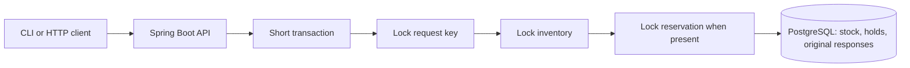
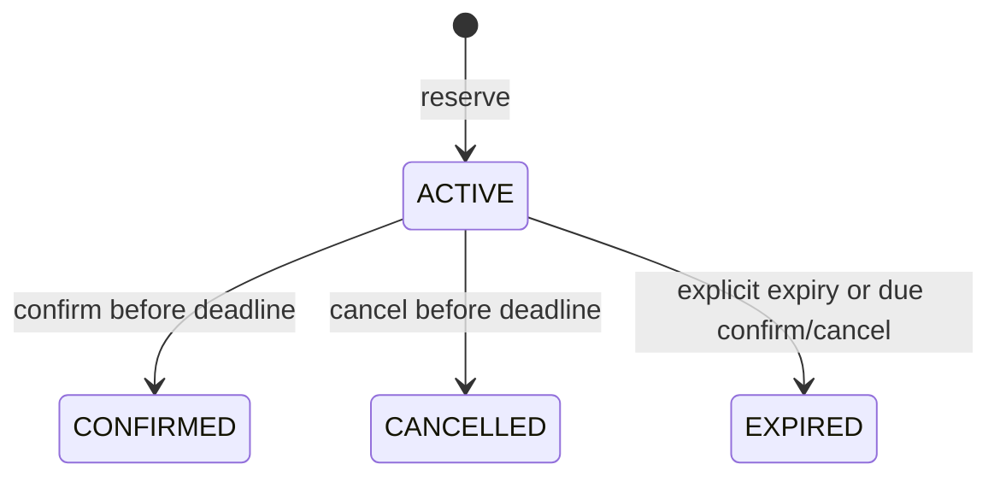

# Stock Reservation Service

[](https://github.com/DmitryLyubaev/stock-reservation-service/actions/workflows/ci.yml)

A small synthetic Java/Spring backend demonstration: reserve one product and quantity,
then confirm, cancel or explicitly expire the hold. PostgreSQL transactions protect stock
and retain the original response for each request key.

[Measured local report](docs/local-report.md) - [API contract](openapi.yaml) -
[Implementation/review decisions](docs/implementation-notes.md) -
[Design](docs/superpowers/specs/2026-10-30-java-spring-stock-reservation-design.md) -
[Implementation plan](docs/superpowers/plans/2026-10-30-java-spring-stock-reservation-local.md)

[Portfolio/interview notes](docs/portfolio.md) -
[Publication provenance](docs/publication-readiness.md)

Publication history starts from a reviewed snapshot. Historical source IDs in the dated
reports refer to preserved private verification history; the publication provenance records
how the implementation bytes match those measurements. The [dated publication run](docs/publication-report-2026-10-31.md) passed A1-A8 with
29 Java and 11 Python checks, actual restart replay and genuine expiry. The
[HTTP method follow-up](docs/http-method-followup-2026-10-31.md) resolves the original
Minor and brings the current suite to 30 Java and 11 Python checks; the CI badge shows
the current hosted result.

## Run locally

Use Linux Docker or WSL Ubuntu with Docker Engine/Compose, Bash, curl and Python 3.11+.
Windows Git Bash commands forward to WSL. Java 25 and Maven run inside pinned containers;
the machine's native Java installation is unchanged. The first run downloads public
images/dependencies; later runs use local caches. Port 8220 must be free.

```bash
bash scripts/verify.sh                 # formatting, build, report gates, real PostgreSQL tests
bash scripts/demo.sh start            # build the normal image and start local services
bash scripts/demo.sh seed             # only for an empty demo dataset
bash scripts/demo.sh reserve 2 ORDER-001 DEMO-RED REQUEST-001
bash scripts/demo.sh show             # inventory
# Copy the returned reservation UUID:
bash scripts/demo.sh show RESERVATION_UUID
bash scripts/demo.sh confirm RESERVATION_UUID CONFIRM-001
bash scripts/demo.sh stop
```

The API is available at `http://127.0.0.1:8220`. It trusts local callers and has no login.
Docker publishes only the API on loopback; PostgreSQL has no host-published port. The
normal image runs as user `10001:10001`. Generated database credentials and raw results
stay under ignored `.local/`. Stop removes owned containers/network and retains the named
data volume and local credential file for the next session. Seeding refuses nonempty data.

## Contract

| Route | Purpose |
|---|---|
| `GET /api/inventory/{productCode}` | On-hand, held and available stock |
| `POST /api/reservations` | Reserve one product and quantity |
| `GET /api/reservations/{id}` | Current state, observation time and overdue flag |
| `POST /api/reservations/{id}/confirm` | Consume the held stock |
| `POST /api/reservations/{id}/cancel` | Release an active hold before its deadline |
| `POST /api/reservations/{id}/expire` | Release a due hold |

```bash
curl -i -H 'Content-Type: application/json' -H 'Idempotency-Key: REQUEST-001' \
  --data '{"order_reference":"ORDER-001","product_code":"DEMO-RED","quantity":2}' \
  http://127.0.0.1:8220/api/reservations

curl -i -H 'Content-Type: application/json' -H 'Idempotency-Key: CONFIRM-001' \
  --data '{}' http://127.0.0.1:8220/api/reservations/RESERVATION_UUID/confirm
```

Mutations require one `Idempotency-Key` of 1-128 ASCII letters/digits or `._:-`.
Order references use the same characters, 1-64; product codes are exact, case-sensitive
seed identifiers. Quantities are integers from 1 to 1,000,000, limited by actual stock.
Bodies are at most 2 KiB; unknown members, coercible strings/floats, invalid quantities
and ambiguous headers are rejected before a key is claimed. Transition bodies are `{}`.

The same key and validated request return the original status and JSON body, including
stored business rejections. Conflicting reuse returns `409 IDEMPOTENCY_CONFLICT`.
Keys are globally scoped to this local dataset and survive application restart. A creation
replay can still show its original ACTIVE snapshot after confirmation; GET shows current
state. An order reference is descriptive and does not deduplicate different keys.

Availability is `on_hand - held`. ACTIVE holds, including overdue holds awaiting an
operation, count toward held stock. Confirmation reduces both on-hand and held; cancellation
or expiry reduces held. All changes and the stored request response commit atomically.
Technical failure rolls them back; lock/statement contention returns retryable `503 BUSY`.
Method rejections from routing return `405 METHOD_NOT_ALLOWED` with the route's
`Allow` header. Existing POST boundary validation can reject malformed requests first.
Neither rejection claims a request key or changes stock.

## State and transaction model





Each hold lasts exactly five minutes. Database `clock_timestamp()` is sampled after the
business locks. At or after the deadline, confirm/cancel commits EXPIRED and releases the
hold while returning `409 RESERVATION_EXPIRED`. Early expiry returns `409 NOT_DUE`.
Terminal states cannot change; a fresh key repeating the achieved terminal action is a
no-op success. Other terminal transitions return `409 INVALID_STATE`.

Expiry is operator-triggered. GET does not release stock and new reservations do not sweep
old holds. Run the expiry command to reclaim due stock. There is one application/database
and one product per reservation; baskets, replenishment and downstream order delivery are
outside this demonstration.

## Reproduce the evidence

```bash
bash scripts/verify.sh --packaged --mode restart
bash scripts/verify.sh --packaged --mode real-clock   # actually waits five minutes
# With committed, clean implementation source:
bash scripts/study.sh
```

Packaged acceptance deliberately resets only this project's disposable synthetic data.
It verifies non-root/loopback boundaries, abrupt SIGKILL recovery and original-response
replay, then a genuine database-clock expiry. Java integration cases separately exercise
20 competing requests against ten units, post-flush rollback, lock waits, deadline races,
database outage and strict validation. Accelerated clock cases are labelled injected time.
Missing Docker/PostgreSQL fails verification; required cases are never silently skipped.

The study saves private raw/JUnit/query evidence and safe `report.md`/`report.json` under
its printed `.local/studies/` directory. Report generation rejects incomplete, dirty,
mixed-source, skipped or inconsistent observations. Renderer unit tests use synthetic
temporary files and are separate from the application evidence. Cleanup runs on packaged
success/failure and reports retained volumes. Source/report dates, sample size and limits
are recorded in the measured report.

The workflow definition uses standard hosted Ubuntu checks and safe job-log/summary evidence,
with no artifact or cache uploads.
Actual publication and hosted results are recorded in the [dated report](docs/publication-report-2026-10-31.md).
No application cloud deployment or paid model call is needed.

## Stack and limits

Java 25, Spring Boot 4.1.2, Boot-managed JPA/Hibernate, PostgreSQL 17.11, Flyway,
Testcontainers, Maven Wrapper and Docker. [Toolchain pins](config/toolchain-lock.json)
record image digests and the formatter compatibility correction. Docker packaging builds
main code only; canonical verification runs the required test suite separately.

This is independently synthetic portfolio evidence. It establishes the measured local
behaviours and hands-on stack work. Production throughput, high availability, distributed
exactly-once delivery, commercial Java tenure and real customer adoption remain unproven.
